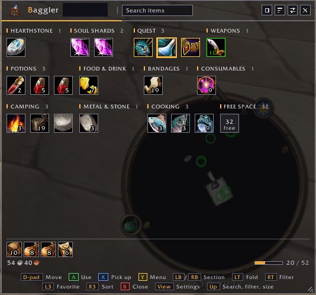

# Baggler · 0.2.0-beta.1

With AI assistance during development, **Baggler** was created as a customizable bag and personal/account bank addon for **WoW Forever**. It grew out of a simple idea: playing with a controller should feel just as natural in your inventory as it does out in the world. Keyboard and mouse remain fully supported, alongside remappable controller navigation, search, categories, favorites, item cards/comparisons and native-window item transfers.

**Public beta.** I use Baggler every day, and feedback from more players is very welcome. Download **`Baggler-0.2.0-beta.1.zip`** from [Releases](https://github.com/CraigTheWorst/Baggler/releases/tag/v0.2.0-beta.1) (not GitHub’s automatic “Source code” archive).

- **Game:** WoW Forever, built and played on client 1.60.1.71037.
- **Input:** keyboard and mouse, controller, or both together.
- **Install guides:** Windows, macOS and Linux (Wine) — see [Install](docs/INSTALL.md).

## Screenshots

In-game screenshots: [gallery](docs/GALLERY.md).

## Start here

- [Install, update and uninstall](docs/INSTALL.md)
- [Install with a local assistant](docs/ASSISTED-INSTALL.md)
- [Usage and controls](docs/USAGE.md)
- [Troubleshooting](docs/TROUBLESHOOTING.md)
- [Beta feedback and known issues](docs/BETA-CHECKLIST.md)
- [Release notes](docs/STATUS.md)
- [Development and tests](docs/DEVELOPMENT.md)
- [Credits and rights](docs/PROVENANCE.md)

Baggler replaces your bags and personal/account bank. Merchant, guild bank, mail, trade, loot and auction windows stay as the game's own windows, and Baggler works alongside them.

## Known issues

- **Combat:** some controller interactions are restricted by the game; report any trouble.
- **UI errors:** UI errors have been reported with several addons enabled; cause not isolated. Please include error text.

Found something else? See [Beta feedback](docs/BETA-CHECKLIST.md).

## License

Copyright © 2026 Craig. **All Rights Reserved**, with free personal installation and use: see [LICENSE](LICENSE). The source being public does not make it open source. Credits and third-party terms are listed in [Credits and rights](docs/PROVENANCE.md).
