# Baggler screenshot gallery

[Back to the README](../README.md) · [Usage](USAGE.md) · [Beta feedback](BETA-CHECKLIST.md)

In-game screenshots, cropped to Baggler's windows. Solid boxes cover player names. They were taken on a pre-release build, so some labels (such as the version in the settings title) may differ slightly from the current release.

## Bags, folded sections and search

### Categorized bag overview

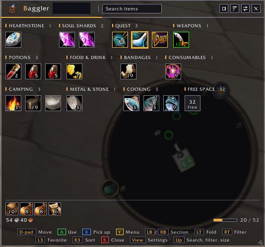

Items grouped into named sections, with free-space count and controller hints. This is the README's overview image.

### Folded bag sections

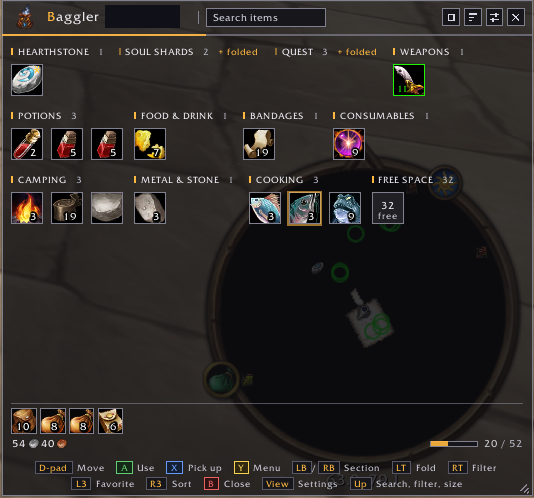

Soul Shards and Quest sections are folded while the other groups remain visible.

### Search highlighting

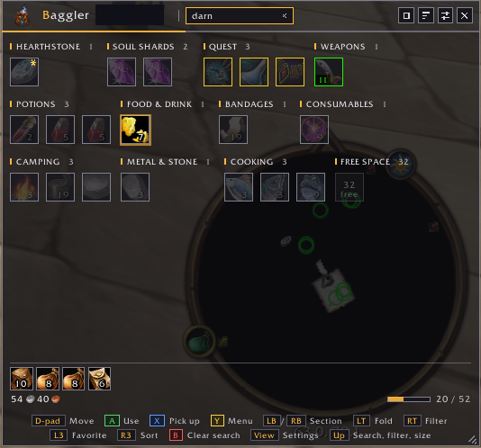

The search field contains “darn”; nonmatching items are dimmed in the bag view.

## Toolbar and item actions

### Destroy drop target

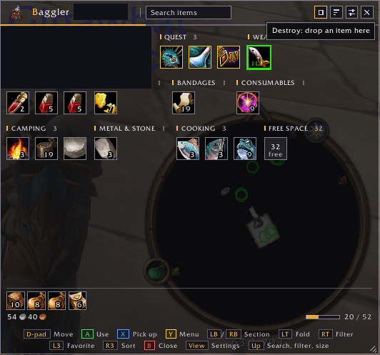

The toolbar tooltip reads “Destroy: drop an item here”.

### Clean-up / sort control

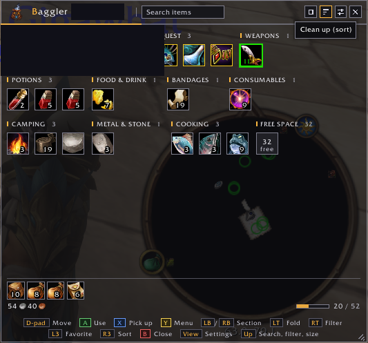

The toolbar tooltip for the clean-up (sort) control.

### Item-binding chord overlay

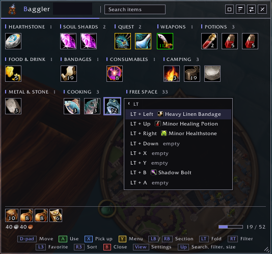

The LT overlay lists the items and spell bound to LT + button combinations, plus the empty ones.

### Item context menu

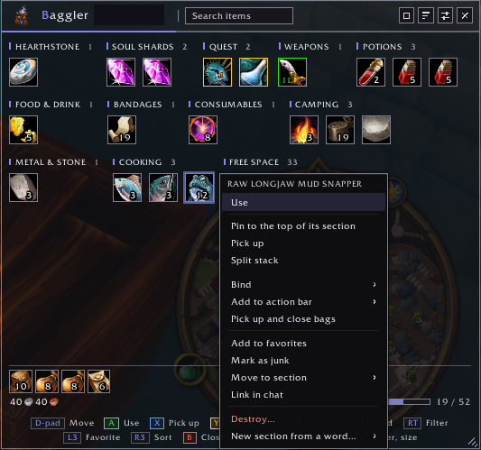

The item menu for a stack of fish: use, pin to top, pick up, split stack, bind, add to action bar, favorite, junk, move to section, link in chat and destroy.

## Settings panels

### Look settings

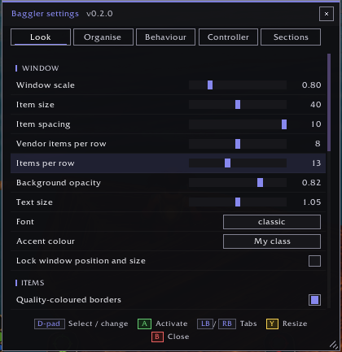

Window scale, item size, spacing, opacity, font and accent options in the Look tab.

### Organise settings

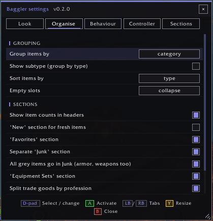

Grouping, sorting, empty-slot and section toggles in the Organise tab.

### Behaviour settings

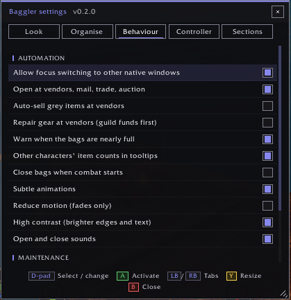

Native-window focus, vendor, low-space warning, item counts, combat-close, motion and sound options in the Behaviour tab.

### Controller settings

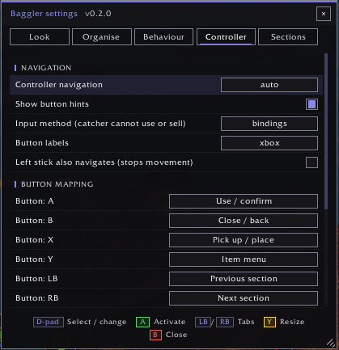

Navigation mode, button hints, input method and action mappings in the Controller tab.

### Custom-section editor

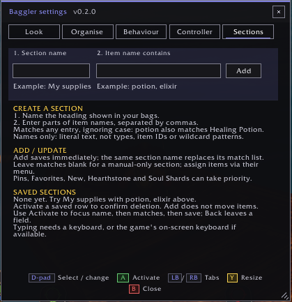

Section name and item-name matching fields with the on-screen section-creation instructions.

## Bank view

### Categorized bank inventory

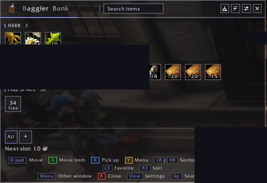

Bank view with a Herb section, free-space count, tab buttons and next-slot price. Some slots and controls are covered where player names showed through the panel.
